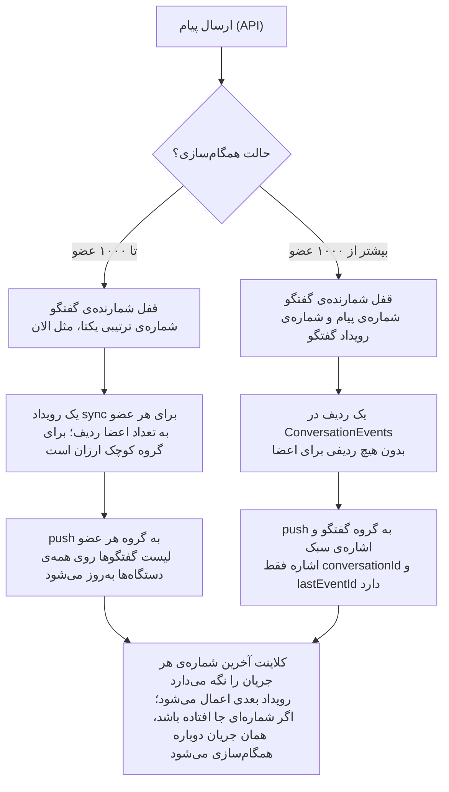

# طرح فنی همگام‌سازی ترکیبی (مرحله‌ی ۳)

وضعیت: **تصویب‌شده** (تصمیم‌ها ۲۰۲۶-۱۱-۱۴، بخش «تصمیم‌ها») · تاریخ طرح: ۲۰۲۶-۱۱-۱۰

## خلاصه و تصمیم

هزینه‌ی هر پیام باید ثابت باشد، نه متناسب با تعداد اعضا. برای این کار گفتگوها دو نوع می‌شوند، مثل مدل `pts` در تلگرام:

- **گفتگوی کوچک** (خصوصی و گروه تا ۱۰۰۰ عضو): مثل الان، برای هر عضو یک رویداد sync با شماره‌ی ترتیبی کاربر نوشته می‌شود. این مسیر بعد از PR #396 درست و هم‌زمان‌پذیر است.
- **گفتگوی بزرگ** (کانال و گروه بیشتر از ۱۰۰۰ عضو): هر پیام فقط **یک بار** با شماره‌ی ترتیبی همان گفتگو ثبت می‌شود. کلاینت‌ها خودشان می‌پرسند «بعد از شماره‌ی N چه آمده؟». برای اعضا هیچ ردیفی نوشته نمی‌شود.

رسید تحویل و خوانده‌شدن در هر دو نوع از جدول `MessageDeliveries` (یک ردیف برای هر عضو در هر پیام) به دو عدد روی `ConversationMember` منتقل می‌شود: `LastDeliveredSequenceNumber` و `LastReadSequenceNumber`. **هر دو ستون از قبل در جدول وجود دارند.**

نتیجه: ارسال پیام در کانال ده هزار نفره از حدود ۲۰ هزار insert به حدود ۵ insert می‌رسد.

## مشکل فعلی

الان هر پیام برای هر عضو سه ردیف می‌نویسد: یک `MessageDelivery`، یک `UserSyncEvent` (همراه با کپی کامل متن پیام) و به‌روزرسانی `UserSyncCounter`. به اضافه‌ی حدود ۵ ردیف ثابت (پیام، گفتگو، شمارنده، outbox و audit). یعنی تقریباً **۳N + ۵** ردیف در یک تراکنش.

| اندازه‌ی گفتگو | ردیف در هر پیام (الان) | ردیف در هر پیام (طرح جدید) | با ۵۰ پیام در روز |
| --- | --- | --- | --- |
| ۲ نفر | حدود ۱۱ | حدود ۹ | ۵۵۰ ← ۴۵۰ |
| ۵۰ نفر | حدود ۱۵۵ | حدود ۱۰۵ | ۷٬۷۵۰ ← ۵٬۲۵۰ |
| ۱٬۰۰۰ نفر | حدود ۳٬۰۰۵ | حدود ۲٬۰۰۵ (زیر آستانه‌ی ۱۰۰۰، فقط `MessageDeliveries` حذف می‌شود) | ۱۵۰ هزار ← ۱۰۰ هزار |
| ۱٬۰۰۱ نفر به بالا | حدود ۳N + ۵ | حدود ۶ | — |
| ۱۰٬۰۰۰ نفر | حدود ۳۰٬۰۰۵ | حدود ۶ | ۱٫۵ میلیون ← ۳۰۰ |

در کانال ده هزار نفره، هر پیام قفل شمارنده‌ی ده هزار کاربر را تا پایان تراکنش نگه می‌دارد. پس پیام‌های هم‌زمان در گفتگوهای دیگرِ همان کاربران هم پشت آن منتظر می‌مانند. همچنین `ConversationBroadcaster` (PR #397) برای گفتگوهای بالای ۵۰۰ عضو فقط به کلاینت‌هایی که گفتگو را باز کرده‌اند پیام زنده می‌فرستد. بقیه تا sync بعدی چیزی نمی‌بینند.

## مدل هدف

مسیر گفتگوی کوچک همان مسیر فعلی است، منهای `MessageDeliveries`. فقط گفتگوهای بزرگ مسیر جدید را می‌گیرند و هزینه‌ی هر پیامشان به اندازه‌ی گروه بستگی ندارد.

## تغییرات مدل داده

| جدول یا ستون | تغییر | توضیح |
| --- | --- | --- |
| `Conversations.SyncMode` | جدید: `PerUser` یا `PerConversation` | با رسیدن تعداد اعضا به آستانه (۱۰۰۰، قابل تنظیم) به `PerConversation` تغییر می‌کند. برعکسش انجام نمی‌شود. کانال‌ها از ابتدا `PerConversation` هستند. |
| `ConversationEvents` | جدول جدید | `ConversationId`، `EventId` (همان شماره‌ی ترتیبی گفتگو)، `EventType`، `MessageId`، `PayloadJson`، `CreatedAtUtc`. ایندکس یکتا روی (`ConversationId`، `EventId`). ساخت، ویرایش و حذف پیام در گفتگوی بزرگ اینجا ثبت می‌شود. |
| `ConversationCounters.LastEventId` | ستون جدید | شمارنده‌ی رویدادهای گفتگو. ویرایش و حذف هم شماره می‌گیرند، پس جدا از `LastSequenceNumber` پیام است. با همان قفل PR #396 گرفته می‌شود. |
| `ConversationMembers.LastDeliveredSequenceNumber` و `LastReadSequenceNumber` | بدون تغییر ساختار | منبع اصلی رسیدها برای هر دو نوع گفتگو. فقط رو به جلو حرکت می‌کنند (`GREATEST`). |
| `MessageDeliveries` | حذف بعد از مهاجرت | رسید هر پیام از روی شماره‌های بالا حساب می‌شود. |
| `UserSyncEvents` | برای گفتگوی بزرگ فقط رویدادهای عضویت | «به کانال اضافه شدید»، «حذف شدید»، «نقش شما تغییر کرد». برای پیام‌های گفتگوی بزرگ ردیفی نوشته نمی‌شود. |
| `ConversationEvents` قدیمی | پاک‌سازی دوره‌ای | بعد از ۹۰ روز (تصمیم‌شده، قابل تنظیم). کلاینتی که بیشتر از این آفلاین بوده، پیام‌ها را از `GET /messages` دوباره بارگذاری می‌کند. |

جدول `Messages` در PostgreSQL بر اساس `CreatedAtUtc` ماهانه پارتیشن‌بندی شود (`pg_partman`). این تغییر مستقل است ولی هم‌زمان با مهاجرت انجام شدنش راحت‌تر است.

## تغییرات API و رویدادهای real-time

| endpoint یا رویداد | نوع | کار |
| --- | --- | --- |
| `GET /sync/{userId}/{deviceId}` | بدون تغییر | رویدادهای گفتگوهای کوچک و رویدادهای عضویت. پاسخ یک فیلد جدید می‌گیرد: `largeConversations`، فهرست گفتگوهای بزرگ کاربر همراه با `lastEventId` هر کدام. |
| `GET /conversations/{id}/events?afterEventId=N&take=200` | جدید | رویدادهای یک گفتگوی بزرگ بعد از N. فقط برای اعضای فعال. اگر N قدیمی‌تر از پاک‌سازی باشد، `410 Gone` برمی‌گرداند تا کلاینت از نو بارگذاری کند. |
| `POST /sync/conversations` | جدید | همان کار برای چند گفتگو در یک درخواست: `[{conversationId, afterEventId}]` ← رویدادهای هر کدام. برای بعد از اتصال مجدد. |
| `POST /conversations/{id}/read` | تغییر | فقط `LastReadSequenceNumber` را بالا می‌برد. دیگر ردیف‌های `MessageDeliveries` را به‌روز نمی‌کند. |
| `message.created` و `conversation.updated` | تغییر | `eventId` گفتگو را همراه دارند. گفتگوی بزرگ: رویداد به گروه گفتگو و یک «اشاره‌ی سبک» (`conversation.hint` با `conversationId` و `lastEventId`، بدون متن) به گروه کاربران می‌رود. |
| `message.delivered` و `message.seen` | تغییر | به جای شناسه‌ی پیام، `upToSequenceNumber` می‌فرستند. در گفتگوی بزرگ فقط شمارش («دیده شده توسط ۱۲۰ نفر») و با تأخیر چند ثانیه‌ای و تجمیع‌شده. |

اشاره‌ی سبک برای ده هزار نفر هنوز ده هزار پیام SignalR است، اما هر کدام چند ده بایت است و بدون کوئری دیتابیس. اگر بار Redis زیاد شد، می‌توان آن را برای کاربرانی که آنلاین نیستند حذف کرد، چون با sync بعدی پر می‌شود.

## رفتار کلاینت

کلاینت برای هر جریان آخرین شماره‌ای را که کامل دریافت کرده در IndexedDB نگه می‌دارد: یک `lastUserEventId` برای کاربر، و یک `lastEventId` برای هر گفتگوی بزرگ.

**تشخیص gap:** هر رویداد real-time شماره‌اش را همراه دارد. اگر رویداد `N+1` برسد، اعمال می‌شود و شماره جلو می‌رود. اگر شماره‌ی بزرگ‌تری برسد، یعنی چیزی جا افتاده. رویداد نگه داشته می‌شود، کلاینت همان جریان را از `N` sync می‌کند و بعد رویدادهای نگه‌داشته را اعمال می‌کند. شماره‌ی کوچک‌تر یا مساوی تکراری است و نادیده گرفته می‌شود. نتیجه: پیامی گم نمی‌شود، حتی اگر اتصال SignalR لحظه‌ای قطع شده باشد. بعد از PR #396 شماره‌ها بدون فاصله‌اند، پس این منطق قابل اعتماد است.

**اتصال مجدد:** یک `GET /sync` و یک `POST /sync/conversations` برای همه‌ی گفتگوهای بزرگ. هر دو موازی و صفحه‌بندی‌شده (۲۰۰ تایی).

**باز کردن گفتگو:** اول از IndexedDB نمایش داده می‌شود، بعد فقط اختلاف از سرور گرفته می‌شود. این همان کلاینت local-first مرحله‌ی ۴ است و روی همین شماره‌ها ساخته می‌شود.

**رسیدها:**

- تیک «رسید»: پیام‌هایی که `SequenceNumber` آن‌ها کمتر یا مساوی کمترین `LastDelivered` اعضای دیگر است.
- تیک «دیده شد»: همان محاسبه با `LastRead`.
- در گفتگوی خصوصی این دقیقاً همان چیزی است که الان نشان داده می‌شود. در گروه کوچک «همه دیدند» نشان داده می‌شود و جزئیات با لمس پیام از سرور گرفته می‌شود. در گروه بزرگ فقط شمارش نمایش داده می‌شود.
- تعداد پیام‌های خوانده‌نشده هم `LastSequenceNumber - LastReadSequenceNumber` است و نیازی به شمردن ردیف ندارد.

## مسیر مهاجرت

هر مرحله یک PR جداست و بدون خاموشی مستقر می‌شود. تا مرحله‌ی ۴ هیچ چیز قدیمی حذف نمی‌شود، پس هر مرحله قابل برگشت است.

1. **Schema و نوشتن دوگانه.** جدول `ConversationEvents`، ستون‌های `SyncMode` و `LastEventId` اضافه می‌شوند. همه‌ی گفتگوها `PerUser` می‌مانند. پیام‌ها علاوه بر مسیر فعلی در `ConversationEvents` هم ثبت می‌شوند. endpointهای جدید فعال می‌شوند ولی کلاینتی از آن‌ها استفاده نمی‌کند.
    - شرط عبور: تست مقایسه‌ای در CI و روی محیط آزمایشی. رویدادهای دو مسیر برای چند گفتگو یکسان باشند.
2. **رسیدها از روی شمارنده‌ها.** سرور رسیدها را از `LastDelivered` و `LastRead` حساب می‌کند. `MessageDeliveries` هنوز نوشته می‌شود ولی دیگر خوانده نمی‌شود. اگر شماره‌های فعلی اعضا عقب باشند، از روی `MessageDeliveries` یک بار پر می‌شوند (backfill).
3. **کلاینت جدید.** فرانت gap detection و sync گفتگوهای بزرگ را دارد و همچنان با گفتگوهای `PerUser` کار می‌کند. چون PWA است، نسخه‌ی قدیمی بعد از اولین باز شدن با Service Worker به‌روز می‌شود.
    - شرط عبور: درصد کاربرانی که روی نسخه‌ی جدیدند (از هدر نسخه در لاگ‌ها) به حدود ۱۰۰٪ برسد.
4. **روشن کردن حالت گفتگو.** گفتگوهای بالای آستانه یکی یکی به `PerConversation` می‌روند، اول یک کانال آزمایشی. برای اعضا یک رویداد `conversation.syncModeChanged` با `lastEventId` فعلی نوشته می‌شود تا کلاینت از آنجا ادامه دهد.
5. **پاک‌سازی.** نوشتن `MessageDeliveries` و رویدادهای پیام گفتگوهای بزرگ در `UserSyncEvents` قطع می‌شود. بعد از یک دوره‌ی اطمینان، جدول `MessageDeliveries` حذف می‌شود.

تست بار (`loadtest/`، نتایج فعلی در [`baseline.md`](baseline.md)) قبل و بعد از مرحله‌ی ۴ اجرا شود: ۱۰ هزار اتصال، یک کانال ۱۰ هزار نفره و چند صد گفتگوی کوچک فعال. هدف: زمان ارسال تا نمایش زیر ۲۰۰ میلی‌ثانیه در صدک ۹۵.

## ریسک‌ها، سؤال‌های باز و تخمین

**ریسک‌ها**

- **دو مسیر کد هم‌زمان.** تا پایان مرحله‌ی ۵، هر تغییر در پیام باید در هر دو مسیر انجام شود. برای کاهش این ریسک، ساخت پیام (که الان در `MessageSender` و دو متد `MessageForwarder` تکرار شده) اول به یک سرویس مشترک منتقل شود.
- **کلاینت قدیمی بعد از مرحله‌ی ۴.** کلاینتی که به‌روز نشده پیام‌های گفتگوی بزرگ را از sync نمی‌گیرد. شرط عبور مرحله‌ی ۳ برای همین است. یک «حداقل نسخه‌ی کلاینت» هم در `GET /auth/config` اعلام شود تا نسخه‌ی خیلی قدیمی به‌روزرسانی را اجبار کند.
- **پارتیشن‌بندی `Messages`.** در PostgreSQL ایندکس یکتا باید کلید پارتیشن را شامل شود. پس ایندکس یکتای (`ConversationId`، `ClientMessageId`) باید `CreatedAtUtc` را هم داشته باشد، یا idempotency به جدول کوچک جداگانه منتقل شود.

**تصمیم‌ها** (مالک پروژه، ۲۰۲۶-۱۱-۱۴)

- **آستانه‌ی گفتگوی بزرگ: ۱۰۰۰ عضو**، به جای ۲۰۰، و قابل تنظیم. گروه‌های تا ۱۰۰۰ نفر مثل الان برای هر عضو رویداد sync می‌گیرند. هزینه‌ی اندازه‌گیری‌شده‌ی هر اندازه در «هزینه بر اساس اندازه‌ی گروه» آمده است.
- **«دیده شده» در گفتگوی بزرگ فقط تعداد است**، مثل «دیده شده توسط ۱۲۰ نفر». فهرست افراد لازم نیست، پس رسید برای هر عضو هم لازم نیست.
- **نگهداری رویدادها: ۹۰ روز.** کلاینتی که بیشتر از این آفلاین بوده، پیام‌ها را از نو بارگذاری می‌کند.

**هزینه بر اساس اندازه‌ی گروه** (مرحله‌ی 2.4، اندازه‌گیری‌شده با `loadtest/` روی ۱۰ هزار کاربر متصل)

ترافیک زمینه حدود ۴۵ پیام در ثانیه در گفتگوهای خصوصی و تیم‌های ۱۰ و ۵۰ نفره بود، به‌اضافه‌ی **یک پیام در ثانیه** در گروه بزرگ. همه‌ی اعضای گروه بزرگ آن را باز کرده بودند و هر اجرا ۲ دقیقه طول کشید. در هر سه اجرا ۱۰۰٪ تحویل انجام شد و هیچ خطایی پیش نیامد.

| اندازه‌ی گروه | ارسال تا دریافت خود گروه: p50 / p95 / p99 | چت خصوصی هم‌زمان: p95 / p99 |
| --- | --- | --- |
| ۲۰۰ | ۴۰ / ۶۴ / ۱۷۵ میلی‌ثانیه | ۲۴ / ۳۰ میلی‌ثانیه |
| ۵۰۰ | ۷۳ / ۹۰ / ۱۱۸ میلی‌ثانیه | ۲۵ / ۳۱ میلی‌ثانیه |
| **۱۰۰۰** | **۱۲۳ / ۱۵۹ / ۱۹۴ میلی‌ثانیه** | **۲۶ / ۴۰ میلی‌ثانیه** |
| ۱۰٬۰۰۰ (کانال، از [`baseline.md`](baseline.md)) | ۱٬۴۲۵ / ۲٬۶۰۹ / ۲٬۹۹۰ میلی‌ثانیه، با یک پیام در هر ۵ ثانیه | ۱٬۰۷۸ / ۱٬۳۲۸ میلی‌ثانیه |

نتیجه‌ها:
- هزینه تقریباً خطی است، **حدود ۰.۱۲ میلی‌ثانیه برای هر عضو**.
- با آستانه‌ی ۱۰۰۰، پیام بزرگ‌ترین گروهی که هنوز رویداد sync هر عضو را می‌نویسد زیر هدف ۲۰۰ میلی‌ثانیه می‌ماند (p99 برابر ۱۹۴).
- پیام‌های دیگران تقریباً اثری نمی‌گیرند.

**حد این اعداد:** هر پیام در گروه N نفره شمارنده‌ی sync هر N عضو را حدود N × ۰.۱۲ میلی‌ثانیه قفل نگه می‌دارد. یک گروه ۱۰۰۰ نفره‌ی خیلی پرکار، مثلاً ۵ پیام در ثانیه، اعضایش را بیش از نیمی از زمان قفل نگه می‌دارد. پیام‌های دیگر آن اعضا هم پشت این قفل می‌مانند. اگر چنین گروهی پیدا شد، آستانه را برای آن گروه پایین بیاورید. `SyncMode` برای هر گفتگو جداگانه تنظیم می‌شود.

**برای مرحله‌ی ۴ (ناهماهنگی با `ConversationBroadcaster`):** الان گفتگوهای بالای **۵۰۰** عضو پیام زنده را فقط به کسانی می‌فرستند که آن گفتگو را باز کرده‌اند. با آستانه‌ی ۱۰۰۰، گروه‌های ۵۰۱ تا ۱۰۰۰ نفره هنوز رویداد sync هر عضو را دارند، ولی عضوی که گروه را باز نکرده push زنده نمی‌گیرد و پیام را با sync بعدی می‌بیند. در مرحله‌ی ۴ یکی از این دو راه انتخاب شود:
- `UserGroupFanOutLimit` به ۱۰۰۰ برود. هزینه‌ی push به ۱۰۰۰ گروه کاربر روی Redis باید اندازه‌گیری شود.
- برای این گروه‌ها همان «اشاره‌ی سبک» گفتگوهای بزرگ فرستاده شود.

**تخمین**

| مرحله | تخمین (یک برنامه‌نویس) |
| --- | --- |
| سرویس مشترک ساخت پیام (پیش‌نیاز) | ۲ تا ۳ روز |
| ۱. Schema و نوشتن دوگانه | ۳ تا ۴ روز |
| ۲. رسیدها از روی شمارنده‌ها | ۲ تا ۳ روز |
| ۳. کلاینت: gap detection و sync گفتگوی بزرگ | ۴ تا ۵ روز |
| ۴ و ۵. روشن کردن، تست بار، پاک‌سازی | ۳ تا ۴ روز |
| **جمع** | **۲.۵ تا ۳.۵ هفته** |
